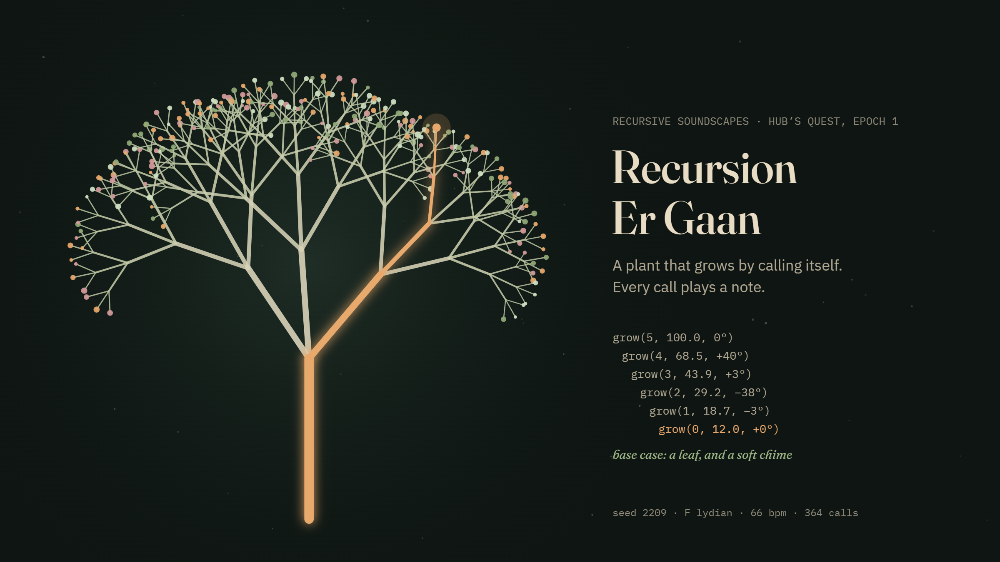
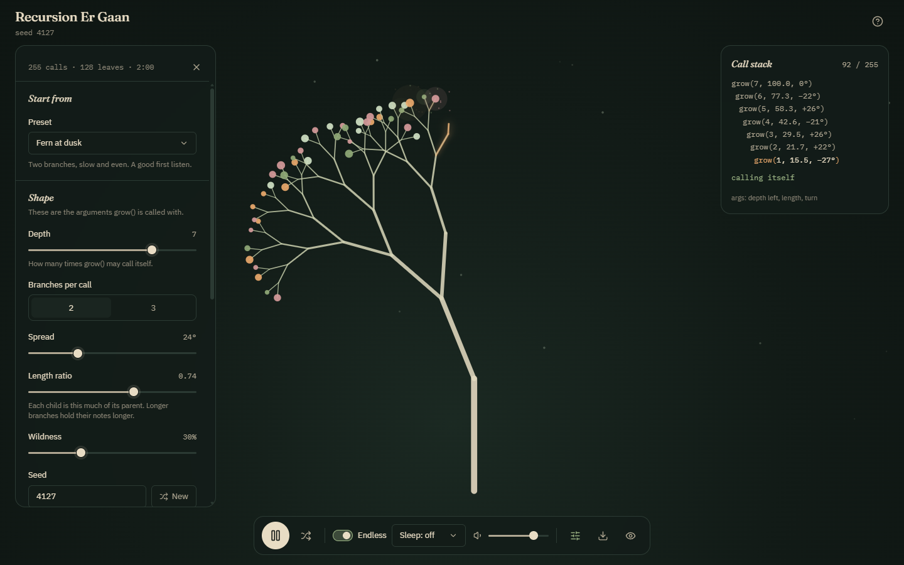

# Recursion Er Gaan

A plant that grows by calling itself. Every call plays a note.

You shape a recursive function with a few sliders, press play, and listen to it run. The plant on screen grows one branch per call, in time with the sound, and a panel next to it shows the live call stack. When you like what you hear you can download it as a WAV, a MIDI file or a picture.

Built solo for **Hub's Quest, Epoch 1: Recursive Soundscapes** (UIU Developers Hub).



**Live demo:** [rumman.is-a.dev/Recursion-Er-Gaan](https://rumman.is-a.dev/Recursion-Er-Gaan/)



---

## The recursive function

Everything comes from one function in [`src/recursion/branch.ts`](src/recursion/branch.ts):

```ts
function grow(level, length, angle, heading, x, y, parent, childIndex, turn) {
  draw a branch from (x, y) along `heading`
  if (level >= depth || length < MIN_LENGTH) return   // base case: a leaf
  for each child (2 or 3):
    grow(level + 1, length * ratio, ±spread + jitter, ...)
}
```

It records every call and every return in the order they happen. That list is the score. Nothing is pre-composed, so a different shape gives a different piece, and the same seed always gives the same one.

### How the recursion becomes music

| In the recursion | In the music |
|---|---|
| Each call to `grow()` | One melody note, in the order the calls happen |
| Turning left or right on the way down | The note steps up or down the scale |
| How deep the call is | Register and instrument: low and warm at the trunk, high and light at the twigs |
| Branch length | How long and how loud the note is |
| A leaf (the base case) | A soft chime, panned left or right to where the leaf sits |
| Returning from a big branch | A low note on the chord root that settles the phrase |
| Each grandchild of the trunk | A new chord in the drone underneath |
| Many calls close together | More wind in the background |

**Rhythm.** Time only moves forward when a call starts. The trunk holds for four beats, its children for two, then one, then eighth notes for the twigs. When every child of a call is a leaf, the leaves are strummed together as a small cluster. A short rest follows whenever a big branch finishes returning, so the piece breathes at the end of each section. Everything sits on a sixteenth-note grid.

**Harmony.** All five scales (major and minor pentatonic, Dorian, Lydian, Hirajōshi) were picked because they stay consonant against an open-fifth drone. Melody and chimes are always in the chosen scale; the tests check this for every scale and several keys.

**Sound.** All sound is synthesised in the browser with Tone.js. No samples are used.
- Drone: detuned sines under a lowpass filter that drifts slowly
- Melody: a soft FM bell, close to a felted marimba
- Leaves: a single oscillator with a few bell partials and a long ring
- Wind: pink noise through a wandering band-pass filter
- Master: delay, reverb, a gentle high-shelf cut, light compression and a limiter at −1 dBFS. Playback fades in and out, and regrowing lets old notes ring out under the new plant, so nothing clicks or cuts off.

---

## What it covers from the brief

| Requirement | Where |
|---|---|
| Recursive algorithm with configurable parameters | Depth, branches per call, spread, length ratio, wildness, seed |
| Interactive simulation or visualisation | Plant drawn in sync with the audio clock, live call stack, glowing active branch, leaves that bloom when they sound |
| Procedural music from the recursive process | `src/music/mapping.ts` (table above) |
| Parameter controls and audio playback | Side panel, transport bar, keyboard shortcuts, presets |
| Audio export | WAV rendered offline through the same signal chain as playback; also MIDI (one track per layer) and a 2048 px PNG |
| Relaxing, accessible experience | Slow tempos, endless mode, sleep timer, focus mode, reduced-motion support, full keyboard control, screen-reader announcements |

## Using it

Press **Play**. The plant grows while it plays. Change anything in the side panel and the plant regrows a moment after you let go.

- **Endless** grows the next seed when a plant finishes, so the music keeps going.
- **Sleep** fades everything out after 15, 30 or 60 minutes.
- **Focus mode** hides everything except the plant.
- Settings live in the URL, so copying the link shares the exact piece.

| Key | Action |
|---|---|
| Space | Play or pause |
| N | New plant (random seed) |
| C | Show or hide controls |
| F | Focus mode |
| E | Download |
| ? | How it works |
| Esc | Leave focus mode or close a dialog |

## Running locally

Needs Node 20 or newer.

```bash
npm install
npm run dev      # http://localhost:5173
npm test         # recursion, mapping and WAV encoder tests
npm run build    # production build in dist/
```

## Deploying

Pushing to `main` runs [`.github/workflows/deploy.yml`](.github/workflows/deploy.yml), which tests, builds and publishes to GitHub Pages. In the repository settings, set **Pages → Source** to **GitHub Actions** once. The build uses relative paths, so any repository name works.

## Project layout

```
src/
  recursion/   branch.ts (grow), timeline.ts (calls → rhythm), rng.ts (seeded PRNG)
  music/       scales.ts, mapping.ts (recursion → notes), engine.ts (Tone.js graph), player.ts
  export/      render.ts (offline WAV + MIDI), wav.ts (PCM encoder), download.ts
  viz/         TreeCanvas.tsx, draw.ts, CallStack.tsx
  ui/          ControlDrawer, TransportBar, ExportDialog, HelpDialog, controls/
  state/       store.ts (zustand), presets.ts, urlSync.ts
tests/         unit tests (Vitest)
scripts/       export-prompt-log.mjs, shoot.mjs (headless screenshot helper)
docs/          PLAN.md, prompt-log/, screenshots/
```

## Built with

React 18, TypeScript, Vite, Tone.js, @tonejs/midi, Radix UI primitives, Tailwind CSS, zustand, lucide icons, Vitest. Type is Fraunces, IBM Plex Sans and IBM Plex Mono from Google Fonts.

## AI use and the prompt log

This project was built with Claude Code. As the rules require, every prompt and the agent's response to it is in [`docs/prompt-log/`](docs/prompt-log/). The log is generated from the session transcripts by `node scripts/export-prompt-log.mjs`; re-run it before submitting so it includes the latest session.

## Licence

MIT. See [LICENSE](LICENSE).
